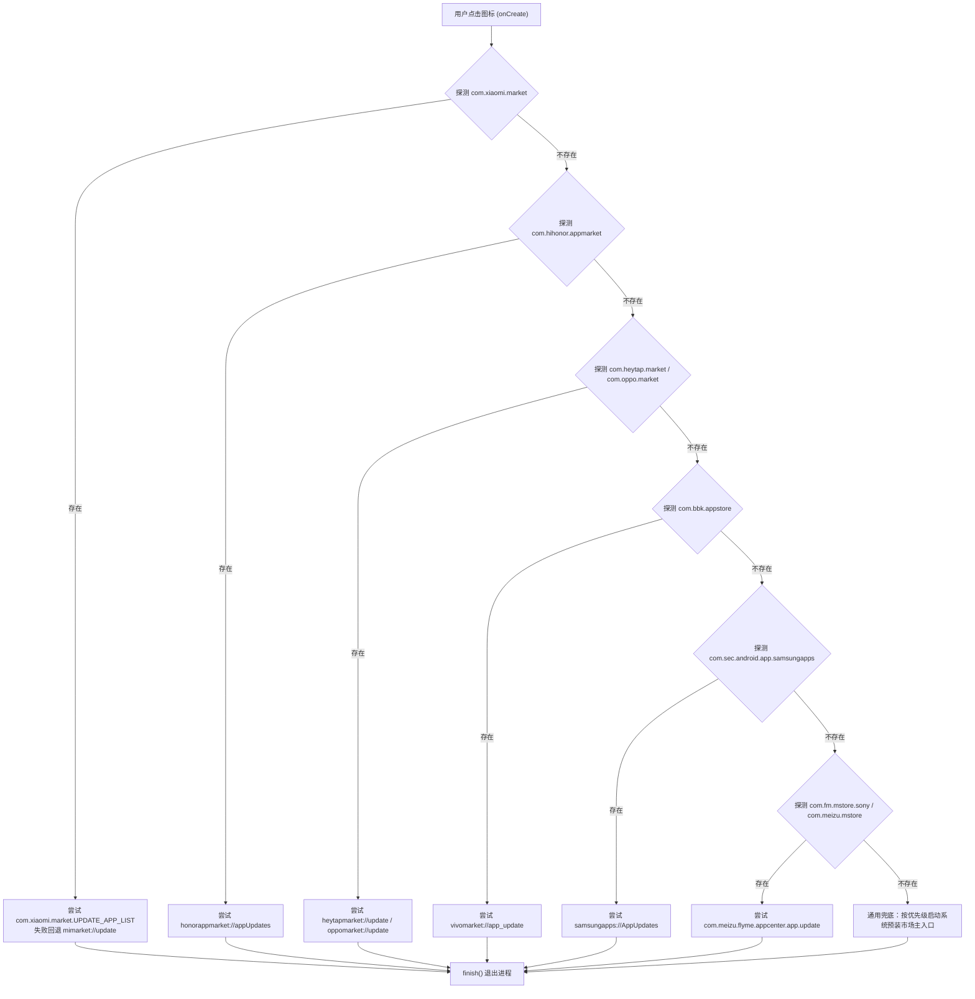

# 商店分发机制 (Market Dispatcher)

## 模块目标

提供一套安全、高效的厂商应用商店识别与 DeepLink 协议派发机制，在无需声明任何权限的情况下，直达各品牌系统自带商店的【全部更新】或【待更新列表】界面。

## 代码位置

- 核心实现：[`app/src/main/java/com/user/quickupdate/MainActivity.java`](file:///D:/Projects/quick-update/app/src/main/java/com/user/quickupdate/MainActivity.java)

## 探测与分发策略

调度引擎在 `onCreate` 中按厂商优先级单次执行，一旦任意协议拉起成功即标记 `launched = true` 并中断后续分支。目前小米（MIUI / HyperOS）已实测验证通过，其余品牌为社区候选协议（待真机进一步回归验证）：

> [!NOTE]
> **兼容性边界**：本项目不支持华为及 HarmonyOS（包括鸿蒙纯血系统 HarmonyOS NEXT 及华为应用市场生态），已从探测链中完全移除。

## 异常与容灾设计

1. **`isInstalled` 安全防护**：调用 `pm.getPackageInfo(pkg, 0)` 捕获 `NameNotFoundException`，防止未安装特定市场引发崩溃。
2. **`tryIntent` 与 `tryUri` 双重容错**：每个 Scheme 请求均用独立的 `try-catch` 包裹。若系统厂商在某些系统子版本（如 Android 14/15 权限收紧或 Scheme 废弃）下抛出 `ActivityNotFoundException`，自动回退到备选 Scheme 或下一个候选策略。
3. **安全退出保证**：无论调度成功与否，`finish()` 都将在方法末尾无条件执行，严禁残留在系统后台占用资源。
